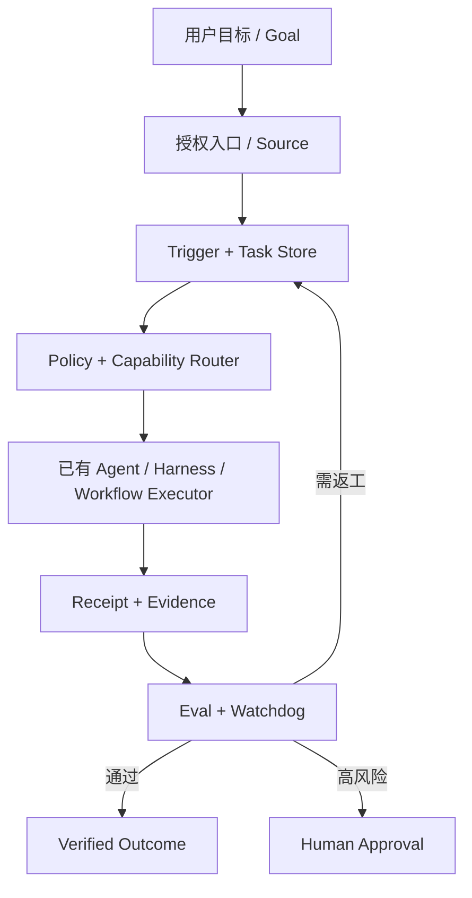
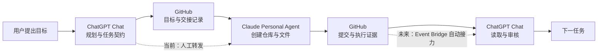

# XSA 架构

> 状态：`design`。本文描述目标架构与领域映射；当前唯一可运行实现是 `experiments/event-bridge-v0.1/` 的离线模拟（`mock`）。本文源自实验期 `xsa-starter/ARCHITECTURE_XSA.md` 并扩展，原件保留在 `experiments/event-bridge-v0.1/xsa-starter/`。

## 总览

## 领域概念与职责

| 概念 | XSA 中的职责 | 与 DeepSeek 原型的关系 |
|---|---|---|
| Goal | 用户目标、边界与验收标准；一切 Task 的来源 | XSA 增设的上层概念，原型中对应人的请求与 Ticket 的目标 |
| Task | 已授权工作单元：唯一 ID、输入版本、状态、审批要求 | 对应 Ticket + Assignment 的组合语义 |
| Source | 事件来源与身份边界：定义什么算事件、持有读取位置 | 直接借鉴原型的 Source |
| Trigger | 不可变事件记录，审计与幂等的单位 | 直接借鉴原型的 Trigger |
| Policy | 版本化准入与评估规则（按 Source 划分允许名单等） | 直接借鉴原型的 Policy |
| Mandate | 一次接受所授予的授权范围与强度，不可变、不可推断扩大 | 直接借鉴原型的 Mandate |
| Executor | 通过适配器接入的已有 Agent / Harness / 工作流 | 借鉴原型的 Executor 端口，XSA 不自研执行器 |
| Receipt | 执行回执：状态、产物引用、证据指纹、错误码 | 对应原型的 Report + Outbox 回执，XSA 将回执与通知分离 |
| Watchdog | 按证据巡检状态与新鲜度，异常去重后才提醒人 | XSA 增设，对应原型「只在需要人时占用注意力」的哲学落地 |

## 四种驱动的统一入口

Goal / Event / Schedule / Workflow（DAG/BPMN）四种驱动都先转成有身份的 Task / Event，再统一走 Policy、状态机与 Receipt。BPMN 是强约束业务流程的一种表示，不是推理模型；定时驱动的登记面复用既有 Registry（如 xingtu-scheduled），XSA 不另建登记表。

## 跨 Agent 接力时序（当前为人工转发，目标为 Event Bridge 自动接力）

实线是 2026-11-02 建仓案例中已实际发生的链路（`verified`，人工接力层面）；虚线标注的是接力方式的现状与演进目标，不得读作自动接力已经实现。

## 状态机（离线原型已实现部分）

`queued -> leased -> succeeded | failed | approval_required`；`leased -> expired` 只表示需要调查，不得立即双跑；重试必须先回收旧租约、核查副作用并受重试预算约束。状态转换不是授权：发布、合并、删除等动作永远需要单独的人工批准。

## 第一阶段不能承诺

- 无法直接控制没有开放接口的 GPT / Muse / 豆包等聊天会话；用户已有订阅不等于可用的 API 额度。
- 没有事务与租约持久化，就不能部署多 Worker 生产系统；仅靠 JSON 文件覆盖的抢锁不算实现。
- Watchdog 的判断必须有真实证据；证据不可读时标 `unverified`，不推断失败。
