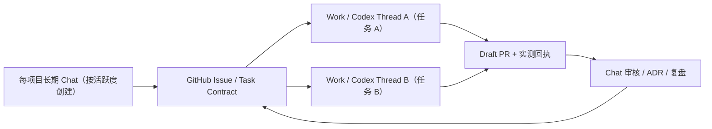

# ADR-0004｜专业主 Chat 长期复用，Work 按任务独立，GitHub 留事实

- 日期：2026-11-02
- 状态：**proposed / Draft PR 待审核**，非已部署的平台功能
- 项目：XSA · Repo-bound Conversation
- 依据：行途 46 仓库/92 提示词启动台的实际迭代，用户对早期 Chatbot 多会话、共享记忆、长会话和 Codex 源码的技术追问
- 决策权限：实施任何自动 Session Binding、生产 Hook、发布或合并均需后续明确审查

## 1. 问题是什么

行途已有不同专业仓库、聊天、Work、Muse 和 Codex，过去靠人手复制提示词重新发起任务。由此出现：

- 会话标题 XSA(work) 与正文 XF(work) 不一致；
- FDE PR #1/#2 修改文件范围重叠，尽管两者都按任务在执行；
- Work 当前工作目录不是 Git 仓且 CodeGraph 没结果，就误判远端仓库完全不可访问；
- 46 仓 × Chat/Work 的 **92 份启动模板**容易被误解为必须新建 92 个实际会话。

最重要的问题不是如何无限增加会话，而是**多个 UI/Agent 在上下文可能丢失、权限不同、时间跨度较长时，如何从稳定事实恢复目标、边界和证据**。

## 2. 历史和产品现实：多会话不是同一个大上下文

- 早期 Chatbot：各 Chat 的消息上下文主要互相隔离；没有跨会话持久的完整事实数据库。
- 记忆阶段：可以引用部分偏好、历史线索，但记忆是提炼和检索，**不能当作历史聊天逐字备份**。[官方 Memory](https://help.openai.com/en/articles/8590148-memory-in-chatgpt)
- ChatGPT Projects：同项目可组织聊天与文件，默认/仅项目记忆的边界不同；**Project-only memory 下 Work 不可用**，不能强制把所有工程 Work 放入这种容器。[官方 Projects](https://help.openai.com/en/articles/10169521-projects-in-chatgpt)
- 单个 Chat 长期使用：便于延续专业讨论，但上下文窗口与检索有边界；重要裁决仍需写入仓库。不能认为“旧内容一直存在于 UI”就代表“旧内容每轮完整送入模型”。

## 3. Codex 开源技术栈与可复用架构

| 构件 | 官方实现/事实 | 对 XSA 的启示 |
|---|---|---|
| Runtime | `openai/codex` 的 `codex-rs` 主要是 Rust；CLI/TUI、exec、核心 agent loop、工具执行/补丁与审批分层 | 不要为 XSA 再做一个完整模型执行内核 |
| App Server | `codex-rs/app-server`，请求/事件模式；外部可经 JSON-RPC 的 stdio/websocket 通道，CLI 可使用进程内 typed client | XSA 只做 Host Adapter / 任务协调；不假定 ChatGPT Work 等同于 Codex app-server |
| Thread / Turn | Thread 持续记录与组织对话/执行，Turn 表示一次任务回合，支持 `thread/start`、`thread/read`、`thread/resume` 等 | Resume 针对**同一执行线程**，不是跨项目共享全部历史 |
| Persistence | `codex-thread-store` 把本地历史存为 JSONL rollout，查询元数据可存 SQLite state DB；历史和元数据有明确边界 | XSA 的 GitHub Task/Issue/PR 不应假充细粒度运行时存储，也不需要复制全部日志 |
| Compaction | Codex 有明确历史 compaction 实现 | 会话可恢复不等于模型一直保有每条原始消息；需要 ADR/checkpoint 保存关键决定 |
| Instructions | `AGENTS.md` 按路径注入指令；Skills/Prompt/配置是不同层次 | 专业仓存规范；各任务另存目标和授权；工具层必须强制执行权限 |
| Concurrency | Thread/subagent/worktree/分支可支持隔离，具体支持取决于客户端和运行形态 | 任务 owner/branch/write scope/PR 冲突检测不能仅靠聊天命名 |

参考原始资料：
1. [Codex 开源代码](https://github.com/openai/codex)
2. [Codex App Server 官方接口](https://learn.chatgpt.com/docs/app-server)
3. [OpenAI App Server 架构文章](https://openai.com/index/unlocking-the-codex-harness/)
4. [Codex thread-store README](https://github.com/openai/codex/blob/main/codex-rs/thread-store/README.md)
5. [Codex 历史压缩实现](https://github.com/openai/codex/blob/main/codex-rs/core/src/compact.rs)
6. [Codex 会话恢复协议](https://github.com/openai/codex/blob/main/codex-rs/app-server-protocol/src/protocol/v2/thread.rs)
7. [Codex Prompt 与 AGENTS.md 说明](https://developers.openai.com/cookbook/examples/gpt-5/codex_prompting_guide)

这些证明了 **Codex 运行时部分** 的技术可能性，**不能证明** XSA 自动接管 ChatGPT 会话、自动从 UI 收消息、自动调度其他产品，或 ChatGPT 普通 Chat 和 Codex Thread 是同一层对象。

## 4. 决策：一仓一入口，不必一仓双常驻

**项目目录**：每个已存在仓都保留独立的专业项目代码及 Chat/Work 启动模板；当前 46 仓覆盖，不代表必须创建 92 个实际会话。仓的归并/拆分属于独立议题，另行研究。

**长期主 Chat**：建议真实活跃的工程使用一个长期主 Chat，负责持续研究、架构、任务裁决、独立验收。相同领域下一轮讨论优先复用，而不是每日重开。出现上下文污染、职责变化、敏感隔离要求或并行对比时，可独立新开，指向同一主仓。

**任务型 Work**：同 `task_id + repo + branch + owner + scope` 且仍在实施/审核，恢复原 Work；新目标/新分支/不同授权或独立验收，开新的 Work，并从 GitHub Issue/PR 读取最新状态，不复制整个旧聊天。执行完成后留真实 Commit/PR/测试证据。

**GitHub SSoT**：Task Contract/Issue 记录目标、决策状态、owner、scope、模型推荐、回滚；PR/Commit/测试记录交付，ADR 记录长期架构裁决。禁止将模型记忆、聊天标题当任务锁或审批凭据。

**左前缀命名**：保持 `XSA (chat)｜Super Agent 工程总控` 这类短标题，其中稳定代码位于左前缀，专业职责紧随其后；实际 `primary_repo` 在启动卡和 GitHub 任务契约中显式写明，完整仓库名可按需作为前/后缀，默认不强制修改现有会话标题。

## 5. 长期单 Chat 的利弊

| 优势 | 代价 / 风险 | 缓解手段 |
|---|---|---|
| 专业语境连续、减少重复解释 | 长历史不保证逐字进入每一轮模型上下文 | 决策 checkpoint/ADR/Issue |
| 模型更容易理解系列工作 | 旧 PR、政策、模型限制可能变化 | 每轮关键动作前检查 GitHub |
| 人类容易返回熟悉的入口 | 同会话混入不相关仓库和授权 | 严格主仓身份与职责，跨仓另立任务 |
| 便于持续研究与审核 | 多次迭代和错判可能在摘要中积累 | 独立 Reviewer + 事实来源引用 |
| 不用管理大量空会话 | 同会话不能充当多个并发 Work 的可靠队列 | GitHub Task Owner / Lease / Conflict Guard |

## 6. 启动台改动边界与实际验证

- 本次仅维护**单文件离线 HTML** `XingTu_Chat_Work_All_46_Projects_v5.html`，包含 46 个项目的完整 Chat+Work 内容。
- 左侧项目编码及主要能力标签，不只看仓库名；分类过滤、关键词搜索与工程卡明确显示定位/主要能力/典型交付。
- Chat 提示词提醒长期复用和 GitHub checkpoint；Work 提示词提醒按任务续用、执行隔离和交接。
- 提供复制当前、复制两份、全选正文、Markdown 下载；复制权限被拒绝时显示手动全选兜底。
- 浏览器同文档内容载入验证了 46×2 提示词切换、搜索、分类、剪贴板成功模拟、拒绝回退、下载和窄屏；**未直接验证 `file://` 打开**，因为测试浏览器对此有限制。
- HTML 包含私有工程仓名称，**不能直接放进公开 XSA 仓库**；如需版本化存入私有 `xingtu-sessions` 或用户受控 Library，须确认发布目标与权限。

## 7. 为什么这比“92 个常驻会话”合理

长期主 Chat 相当于人类的**专业讨论/决策入口**，Work/ Codex Thread 是具体任务执行生命期，GitHub 是跨产品 durable 的契约/证据层。

对用户注意力及 Plus 使用额度，首先改善**任务/事实/权限/验收**而不是要求所有任务上更强模型。Chat/Work 模型推荐另见 [MODEL_ROUTING_POLICY_V1.md](../governance/MODEL_ROUTING_POLICY_V1.md)。

## 8. 后续检验与验收

1. 任意一个旧项目 Chat，隔一周再续聊时能否只读恢复最新 Issue/PR、正确辨认已批准 vs 待审？
2. 同任务复用 Work 能否准确识别 `task_id/branch`，避免再开 PR；新任务开 Work 是否天然隔离冲突？
3. 比较“长 Chat + GitHub checkpoint”与“每次新 Chat 复制提示词”的人工补上下文次数/误判率/质量，不凭感觉声称定量节省 Token。
4. 当 XSA Session Binding 实际可运行时，另行证明 Source→任务→执行→回执的自动事件链，并采用真实权限与故障注入测试。

**必须保留的边界**：本 ADR 只确定推荐的工作方式，不自动创建或删除聊天，不保证跨会话记忆永久完整，不实现自动模型路由，也不自动合并 GitHub PR。
