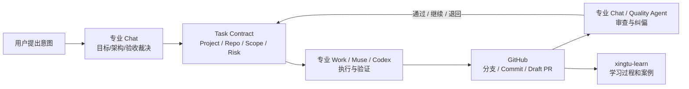

# XSA Case 003｜Chat 规划、Work 执行、GitHub 留证：第一次 Repo-bound Conversation 实践

> 事件日期：2026-11-02。状态：**已发起 Work，尚未验收交付**。来源：用户提供的 ChatGPT Work 截图与同一会话内的任务要求。此文为基于可观察内容的事实整理，不是逐字聊天记录，不是可公开的原始截图。  
> 事实与假设严格区分：**截图无法证明 GitHub PR 已生成或 Work 已完成**。

## 一、实地观察

用户把项目会话固定为：

- `XSA (chat)｜Super Agent 工程总控`：架构、授权、跨仓关系、工程决策。
- `XF (chat)｜FDE 知识与工程实践`：FDE 理论/实践/工具规划。
- `XSA (work)｜Super Agent 工程实施`：截图左栏实际命名。
- 截图中的 **Work 任务消息实际上是** `XF (work)｜FDE 工程建设`，`primary_repo=xingtu1996/xingtu-fde`，`controller=xingtu1996/xingtu-super-agent`。
- Work 界面模型选择器显示 **GPT-6.1 Sol · 高**；消息内推荐相同的模型与强度。
- Work 界面显示执行/连接中的状态（包括「正在重新连接 4/5」的界面提示），未显示完整的成果验收报告。

### 重要纠偏：显示名与任务绑定不一致

截图会话列表为 `XSA (work)`，消息的任务身份则为 `XF (work)`。这不是小小的排版问题；当任务自动恢复、状态聚合和 Agent 并行时，**根据聊天标题猜测主仓库会派错任务**。应以可机读的 **binding manifest** 和远端任务凭证为准，标题仅供人看。

建议这次 FDE 实施会话重命名为 `XF (work)｜FDE 工程建设`；真正做 XSA 核心执行的 Work 使用独立的 `XSA (work)｜Super Agent 工程实施`。修改聊天标题是用户或 Work UI 操作，本研究文档不冒充已经修改。

## 二、真实流程与下一阶段目标



**目前真正跑通的部分**：人工从 Chat 取任务包、创建 Work 会话、选定模型与高推理强度、发送工程实施指令。  
**仍待证实**：Work 是否完成对目标仓库的读取、建仓、实际修改、测试与 Draft PR；GitHub 是否能作为运行时双向事件桥接；无人工转发的自动触发。不能把协作约定写成已经上线的 XSA Session Binding。

## 三、Repo-bound Conversation Convention v1（提案）

会话标题：`<ProjectCode> (<chat|work>)｜<具体职责>`，例如：
- `XSA (chat)｜Super Agent 工程总控`
- `XSA (work)｜Super Agent 工程实施`
- `XF (chat)｜FDE 知识与工程实践`
- `XF (work)｜FDE 工程建设`

每次正式任务都声明（**不是工具自动配置字段**）：

```yaml
contract_version: xsa.session-binding.v0
project: XF
role: fde-engineer
mode: work
primary_repo: xingtu1996/xingtu-fde
coordination_repo: xingtu1996/xingtu-super-agent
task_id: proposed-or-recorded-task-id
allowed_actions: [read, create_branch, create_file, open_draft_pr]
forbidden_actions: [force_push, merge_without_review, publish_private_data]
owner: assigned-agent-or-user
branch: isolated-task-branch
model:
  recommended: "GPT-6.1 Sol"
  effort: high
  actual: "verify-from-UI-or-run-log"
evidence:
  required: [source_revision, changed_files, commit_sha, tests, draft_pr]
status: planned
```

`task_id` 不可凭想象写成已注册的系统 ID；`actual` 不能从自然语言“推荐模型”直接推断，须核对运行时。

### 未来实现需要的两个保护

1. **Namespace Guard**：实际 `project`、`primary_repo`、预期文件作用域与 Work 名称不一致时，通知并暂停跨仓写入，不猜测哪个是真相。用户可修正标题或 manifest。
2. **Execution Receipt**：只有有分支/Commit/PR/测试链接才认定 `delivered`；请求已发送、模型已选、进度动画都只能标记 `started` 或 `running`。

安全原则：UI 的「完全访问」或相似标签不是无限执行授权。仓库写入、公开、合并、生产发布仍受真实连接器/用户安全权限约束，批准边界以实际主机为准。

## 四、素材证据清单

| 素材 | 存放位置 | 对外说明 |
|---|---|---|
| 用户提供的完整 Work 截图 | ChatGPT Library 私有路径 `/XSA_工程实践素材/CASE003_2026-11-02_original_private.png` | 不直接公开；左栏有无关历史会话 |
| Work 消息 + 模型选择局部截图 | Library `/XSA_工程实践素材/CASE003_Work任务与模型_局部截图.jpg` | 如需公开，需最后核对隐私与时间线 |
| XSA Work 标题局部截图 | Library `/XSA_工程实践素材/CASE003_会话命名_局部截图.jpg` | 用于展示“会话标题 ≠ 实际工程绑定”的反例 |

Library 文件仅在用户自己的资源范围内存放，**不是 GitHub 上可直接访问的公开链接**。将来发布文章/README，需先明确选择可发布的裁剪图，再由获授权执行端上传 GitHub；不能写成已公开上传。

## 五、验收与后续实验

- A0：让正在执行的 Work 给出真实主仓/分支/Commit/PR 与实际 Model/Effort；未产出则标 `in_progress` 或 `blocked`。
- A1：若这次会话实际做 XF，改标题 `XF (work)` 并声明 manifest，核对 GitHub 写入目标是否正确。
- A2：同一项目另开 Work，测试只读读取 manifest 是否能恢复背景；避免依赖长聊天。
- A3：同文件两个 Agent 并发时拒绝盲写、采用分支隔离和 SHA 前置校验。
- A4：比较人工交接次数、Work 执行费用和合格交付质量，不声称“Chat 免费”或已节省多少 Token。

## 六、知识与内容价值

这个案例的真正成果不是某个模型快不快，而是把工作流程显式化：

> Chat 负责规划与裁决；Work 负责工程实施；GitHub 负责状态与成果。

并引出更深刻的设计结论：

> **会话名称是人类导航，Session Binding 是机器契约，GitHub 回执是交付证据。**

另见 [xingtu-learn 进行中的学习专题](https://github.com/xingtu1996/xingtu-learn)；与 Case 002（Muse GitHub 权限/冲突）共同支撑 XSA 的 Coordination Guard 与授权治理设计。
