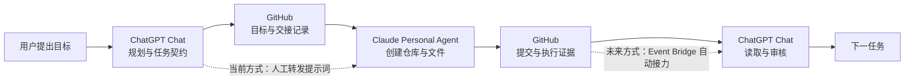

# 架构图：跨 Agent 接力（建仓案例）

> 本图据 2026-11-02 初始化任务所附原图重绘为 Mermaid 源码（原图为渲染截图，无源码留存）。它记录的是 XSA 第一个公开案例的实际链路：不是预先设计的演示，而是真实协作中遇到能力差异后，通过专业 Agent 接力解决问题的过程。

读图说明：

- 实线链路已于 2026-11-02 真实发生（人工接力层面，状态 `verified`）。
- 虚线表示接力方式：当前靠用户人工转发；Event Bridge 自动接力仍是 `design`，不得读作已实现。
- 图中每个交接点都要求结构化证据（提交 SHA、文件清单、测试结果），而不是一句「已完成」。
