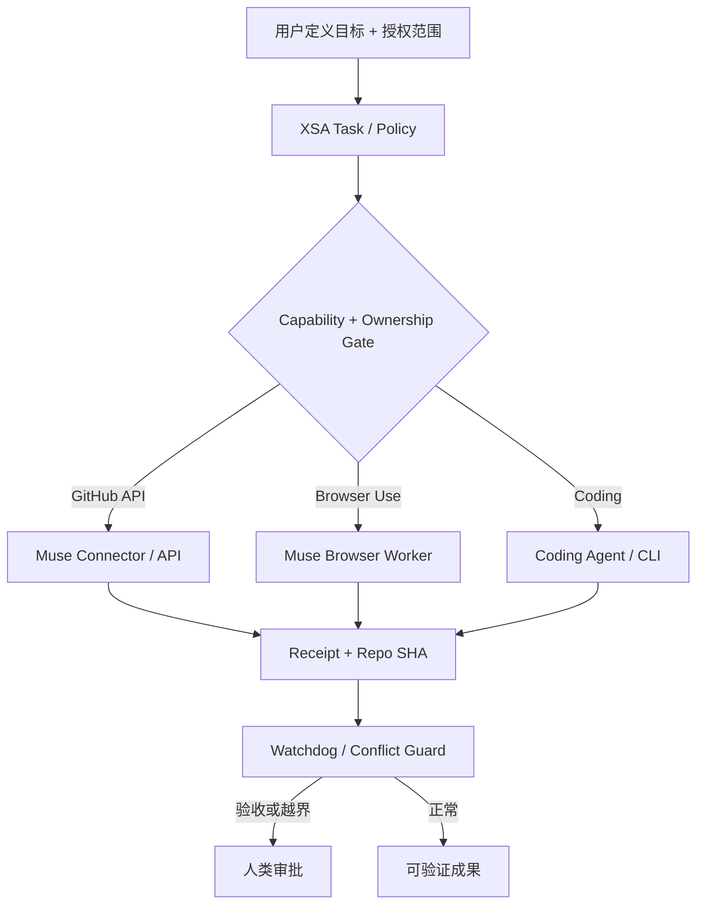

# XSA Case 002｜Muse GitHub 授权弹窗与多 Agent 并发治理

> 记录日期：2026-11-02 · 类型：真实交互观察与设计假设 · 状态：待本地验证  
> 资料来源：用户在协作会话中提交的 Muse UI 截图和口述；本文件是忠实整理稿，不是逐字对话导出。暂不嵌入截图原件，避免意外曝光界面账号或敏感状态。

## 1. 发生了什么（可观察事实）

- 用户通过 ChatGPT 规划 XSA，之后手动转发任务给 Muse。Muse 使用其浏览器能力创建了公开的 `xingtu1996/xingtu-super-agent` 仓库。这是**人工接力成功**，不是 ChatGPT 向 Muse 自动推送事件成功。
- Muse 随后准备向 XSA 新仓的独立分支推送一组初始化文件。界面显示 *Push files to GitHub* 的审批弹窗和具体分支/文件路径；用户需要反复点击「允许」。
- Muse 设置 → 权限 → GitHub 页面展示：**读取 GitHub 存储库内容＝允许；更改 GitHub 存储库内容＝请求；后台同步＝允许**。
- Muse 设置 → 权限 的全局默认项展示：**连接器＝请求某些操作；网络访问＝请求某些操作**。
- 同一时期，另一个 Agent 已在 XSA 的独立研究分支整理 Orca/Orka/DSH，学习仓也有独立专题分支。用户提醒避免并行写入冲突；其他执行方停止对相关仓库继续写入。
- 截图只能证明用户界面可见状态，不证明 Muse API/浏览器两条权限路径共享授权，也不证明某个「允许」可持续至整个任务。

## 2. 用户真实诉求

> 希望在明确授权一次后，Muse 可以在许可的范围内连续完成 GitHub 初始化及文件提交，不要每一次低风险写操作都重新确认；同时多个 Agent 不能互相覆盖成果。

用户并不要求绕过平台安全控制；希望以减少无效审批为目标，同时保留高风险决策的人工控制。

## 3. 授权机制：已知与未知

| 事项 | 当前结论 | 证据类型 |
|---|---|---|
| GitHub Connector 当前写入配置为「请求」 | 已确认 | 用户截图 |
| 全局连接器默认「请求某些操作」 | 已确认 | 用户截图 |
| 可在该设置页面调整连接器授权策略 | 可从界面推断存在下拉菜单；具体选项待展开确认 | 用户截图 |
| 是否支持「仅此任务」「会话级」「限时」「始终允许」 | **待本机逐项核实** | 截图未展示选项列表 |
| 改为「允许」后能否省去所有写入确认 | **不能保证**：取决于动作类别与应用安全策略 | 待实测 |
| 浏览器建仓与 GitHub Connector 写入是否共用授权 | **未知，按独立路径治理** | 待实测 |
| 是否支持只对指定 repo 授权 | **待核实 GitHub App 安装的实际仓库范围与设置** | 待实测 |

建议：先尝试界面实际提供的**任务范围授权**；若只有连接器级「允许」，先核对仓库访问范围和生产仓风险，切勿为免弹窗直接开启无限制写权限。高风险动作（公开隐私、修改权限、删仓、生产发布、合并）始终单独审批。

## 4. XSA 产品设计结论：Coordination Guard + Authorization Ledger

- **Task Authorization**：将授权绑定 `task_id`、发起者、明确目标、允许的 actions、仓库与分支、有效期、最大操作次数、风险等级；超范围拒绝并请求人工确认。
- **Capability Gate**：对 Muse Browser、Muse GitHub Connector、Codex CLI 等分别申明 transport、权限、真实支持情况；不能把模型声称有权限当作授权凭据。
- **Ownership / Lease**：每个任务声明 owner、分支、文件作用域、租约与续约；同文件或同 side-effect 的并发任务提前告警。
- **Idempotency**：写入键包含 `task_id + action + input_revision + target`；外部副作用按回执和远端 SHA 确认，重试前先检查历史结果。
- **Receipt**：记录请求方、执行方、动作、批准范围、目标 repo、分支、Commit SHA、执行结果、审批依据、失败码；敏感身份/Token 不进入公开仓。
- **Conflict Response**：发现两个 Agent 有相同修改目标时，暂停后到者的写入、保留两份 Diff 并等待合流；不得自动 force-push。
- **Attention Budget**：安全边界不变的连续低风险步骤由明确授权的执行者完成；新增风险或越界才提醒用户。

### 交接架构

## 5. 低风险验证清单（仍待执行）

1. 展开 GitHub「更改存储库内容」下拉框，记录**实际出现的授权选项**，不靠其他版本文档推断。
2. 测试在专门实验分支连续提交 2 个无敏感信息的小文件，统计每个操作的审批次数；对比任务授权前后。
3. 分别测试 Connector 写文件和 Browser 建立无实际发布风险的草稿操作是否共用授权（不得改动生产系统）。
4. 核实 GitHub App 是否能限制到 XSA 实验仓；改变安装范围前列出会受影响的现有 Muse 工作。
5. 人工模拟同文件冲突、重复提交与执行成功回执丢失，确保无双写、无重复副作用。

## 6. 与其他研究及 GitHub 证据的关系

- XSA 技术研究：[Orca / Orka / DSH](./ORCA_ORKA_DSH_2026-11-02.md)；两份材料均为研究分支草案，不是已投入生产的实现。
- XSA 初始 Event Bridge 原型：[xingtu-harness PR #4](https://github.com/xingtu1996/xingtu-harness/pull/4)。
- 学习专题：[xingtu-learn 的 XSA 学习笔记](https://github.com/xingtu1996/xingtu-learn/tree/study/xsa-cross-agent-orchestration-20261102/10-tech/xsa-super-agent)。

## 7. 尚待裁决

- 哪一类写入可按任务批准、哪一类必须逐次批准，由 Muse 的实际授权界面和用户风险偏好决定。
- XSA 的权限账本是我们的设计目标，**不能越过 Muse/浏览器/GitHub 自身的权限控制**。
- 不为消除弹窗采用浏览器脚本绕过确认、永久保管 Cookie 或泄漏个人令牌。
