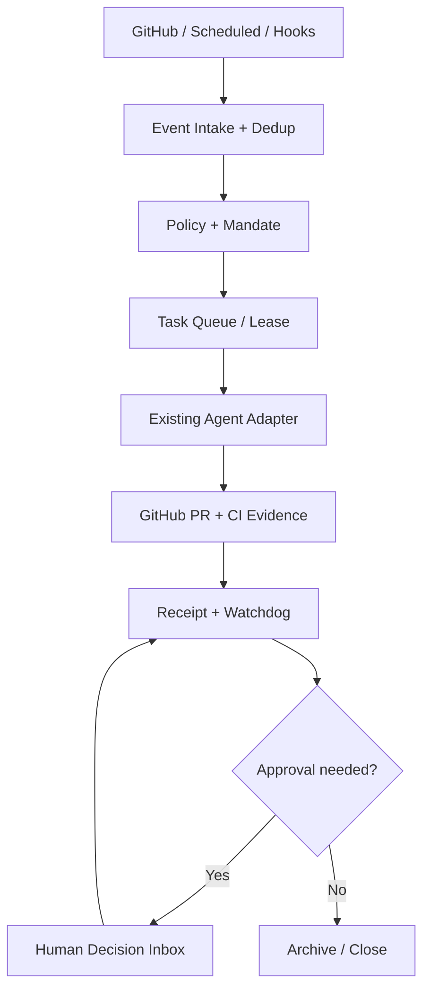

# XSA Agent Workbench：卡兹克自动化系统架构对标与 MVP 决策（2026-11-03）

> 状态：设计提案 / 待审。本文不是功能已上线声明。公开资料仅作为作者自述，未经独立复现实测。

## 结论

XSA 定位为 **Agent 工作台背后的控制平面**：统一事件入口、任务状态、策略授权、执行器适配、证据回执和人工决策；Workbench 是观察与审批入口，不是新的 Agent Runtime。优先验证「事件中台 + 本地执行器 + 独立质量门禁」最小闭环，不复制复杂 UI、不另造 CI 或 Coding Agent。

## 参考来源与证据边界

- 原始 X 帖：https://x.com/khazix0918/status/2117054043868860521
- 作者文章转载：https://www.woshipm.com/ai/6487627.html （数字生命卡兹克，2026-11-02）
- DeepSeek 原型：https://github.com/deepseek-ai/dsh-superagent-prototype
- XSA 当前基线：本仓 README.md 与 docs/ARCHITECTURE.md
- 作者所述 rules.json、Mac 长轮询接单、去重并发、飞书审批、独立 CI 五阶段等，均属于**外部案例描述**，不是 XSA 已实现能力；作者披露的 PR 审查数量和性能数字未独立审计。

## 逐项架构对标

| 外部实践 | XSA 对应 | 现有证据/状态 | 差距与决策 |
|---|---|---|---|
| 定时/Webhook/消息统一事件 | Source / Trigger / Event Bridge | mock：内存路由与去重 | P0：事件 envelope、持久化、签名验证 |
| rules.json 事件路由 | Policy / Mandate / Capability | design；已有协议概念 | P0：版本化规则与最小权限；不让模型自行扩权 |
| 本地 Mac 主动领取任务 | Executor Adapter | design | P1：出站拉取、租约、心跳、超时重领；避免公网暴露本地机 |
| 同一对象去重、限制并发 | Task 幂等键 | mock：task_id + kind + input_revision | P0：事件去重与业务对象串行锁分离；防重复副作用 |
| 单一审批通知出口 | Approval / Receipt | design | P0：聚合审批、拒绝留痕、通知降噪 |
| 独立 CI：审查/检查/合并/发布/核实 | Harness + GitHub CI + Receipt | 真实接入未验证 | P1：先复用 GitHub Actions 与已有检查，禁止自建 CI 抢跑 |
| 可视化自动化流水线 | Workbench | design | P2：先任务表、状态、证据链接，再做动画/三维 |
| 经验与决策沉淀 | Rules / Learn / Receipt | 分仓规划 | P1：审批决策、失败原因、回归用例可追溯 |

## 建议的最小控制平面

**协议最小字段**：event_id、source、kind、object_ref、occurred_at、input_revision、idempotency_key；task_id、goal_id、policy_version、mandate_scope、assignee、status、lease_until、attempt；receipt_id、result、artifact_refs、evidence_refs、error_code、review_status、approved_by、decision_at。

**状态机**：observed → admitted → queued → leased → running → submitted → verifying → completed；异常分支 blocked / approval_required / failed / expired / cancelled。提交 PR ≠ 完成；没有可验证回执 ≠ 成功。

## MVP：GitHub 待办自动收口（先只读 + dry-run）

1. 从 GitHub PR、CI、Scheduled Registry 采集事件，统一格式并记录来源。
2. 用明确的规则匹配任务；同一对象防并发，事件重放不得造成重复写入。
3. 只读诊断和草拟动作可自动执行；创建分支/PR 等可逆动作需明确授权与审计。
4. 复用现有 GitHub 审查与 CI；将检查结果写为结构化 Receipt。
5. 冲突、隐私、生产部署、外部发布、不可逆操作必须阻断并等待人工批准。
6. Workbench MVP 只显示任务状态、阻塞原因、证据、下一步动作和审批入口。

## 验收与回退

- 测试 T1：重复 Webhook/定时事件注入，同一 revision 只生成一个有效任务；跨 revision 能重跑。
- 测试 T2：Worker 离线或租约超时，任务能恢复且不会重复执行危险副作用。
- 测试 T3：失败 CI、隐私风险和发布请求均被阻断；没有人工审批不能越过门禁。
- 测试 T4：每条 completed 任务有产物引用和独立核验记录；缺失即标 unverified。
- 指标：人工介入次数、交付周期、失败恢复时间、重复副作用、Token/成本、审批噪音；建立人工基线再比较。
- 回退：关闭事件写入与自动调度，保留只读观察和已有 GitHub 工作流；不得自动发布或自动合并高风险变更。

## 仓库边界与实施顺序

- xingtu-super-agent：协议、控制平面、Workbench 最小视图与适配器规范。
- xingtu-scheduled：Registry 与定时触发来源。
- xingtu-hooks：事件采集；xingtu-skills：能力契约；xingtu-rules：策略治理。
- xingtu-harness：质量门禁和工程安装；xingtu-learn：A/B 指标与实验记录。
- 私有 xingtu-vault 仅作为经授权的测试场景，公开文档必须脱敏。

**下一步**：审查本提案 → 只读接入验证 → mock 到真实事件桥 → 本地 Worker 拉取实验 → 审批/回执闭环 → 再决定是否开发丰富 UI。任何设计、mock、verified、production 状态都须按证据明确标注。
