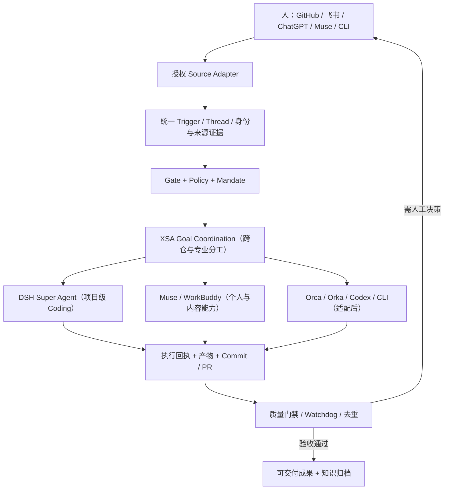

# 从 DSH Super Agent 到 XSA：官方文档 000–008 深读与架构裁决

> 2026-11-02 · 研究/设计状态 · 目标：优先复用上游；当前未部署 DSH、飞书机器人或真实跨 Agent 自动接力。  
> 上游：[DeepSeek dsh-superagent-prototype](https://github.com/deepseek-ai/dsh-superagent-prototype)；官方明确称为 **研究原型，并非正式 DeepSeek 产品**。文档设计有部分未在公开原型实现，不能把所有特性当作生产可用。
>
> 与现有实验衔接：[XSA Event Bridge v0.1](https://github.com/xingtu1996/xingtu-harness/pull/4)；[Orca/Orka/DSH 研究分支](https://github.com/xingtu1996/xingtu-super-agent/pull/1)。

## 1. 第一性原理：哪里重复造轮子？

我们目前：ChatGPT Chat 定目标→人工转述给 Muse/Codex→GitHub PR/Commit→ChatGPT 再审→返工。上游 dsh-superagent 已在**单仓范围**提供 GitHub/可选飞书 Source、事件授权、Ticket、独立执行 Session、工作目录、PR 回话、面板与恢复规则，覆盖了这条链路的主要结构。

**决策：不要重新实现一个单仓主动 Coding Agent。** 先测试上游 DSH 执行系统能否作为 XSA 的一类 Executor，并通过上游扩展点建立跨源入口。XSA 自己必须证明的差异是：**跨仓目标治理、跨执行环境能力路由、FDE/内容/工程等专业角色协调、可验证成果与统一授权链**。这些也要先查 Orca/Orka/DSH 能否复用。

## 2. 官方 docs 000–008 的学习清单

| 官方文件 | 设计要点 | XSA 借鉴与差异 | 优先级 |
|---|---|---|---|
| [000 Philosophy](https://github.com/deepseek-ai/dsh-superagent-prototype/blob/main/docs/000-philosophy.md) | 尽量少消耗人的注意力；仅被允许的用户/规则发起；健康状态静默；尽量少概念 | 每条通知必须有结果/异常/待决策证据；停止空泛日报与重复请示 | P0 |
| [001 Domain Model](https://github.com/deepseek-ai/dsh-superagent-prototype/blob/main/docs/001-domain.md) | Source→Trigger→Thread→Eval→Ticket+Mandate→Assignment→Executor；Subscription 将后续 Thread 输入送到已有 Ticket；Correlation 只加上下文不路由 | 复用实体语义，明确“授权 ≠ 上下文”；跨仓目标在 XSA 薄协调层实现，不污染上游 Ticket | P0 |
| [002 Authorization](https://github.com/deepseek-ai/dsh-superagent-prototype/blob/main/docs/002-authorization.md) | 确定性 Gate + 模型 Assessment；明确/推断授权强度；Policy 版本与 Mandate 重校验；机器人不能冒充显式人的请求 | 给 ChatGPT/Muse/飞书/GitHub 定义 Source-native Actor、权限和来源链；禁止模型自行扩权 | P0 |
| [003 Execution](https://github.com/deepseek-ai/dsh-superagent-prototype/blob/main/docs/003-execution.md) | 每 Ticket 有独立 Executor Session/目录；并发名额；Ticket 状态与执行器状态分离；失败、恢复、重试 | 先测试上游 Executor；跨工具交接映射为 Assignment，重试前检查实际副作用 | P0 |
| [004 Prompts](https://github.com/deepseek-ai/dsh-superagent-prototype/blob/main/docs/004-prompts.md) | Host 工具约束高于 prompt；主 Session 只路由，专业执行者做技术判断；Prompt 版本可追踪；简短回话 | 主会话承担目标/授权/交接，避免反复让高能力模型跑检索和监控 | P1 |
| [005 Panel](https://github.com/deepseek-ai/dsh-superagent-prototype/blob/main/docs/005-panel.md) | 只突出等人工处理、正在执行和任务历史；设置按 Source / Policy / Execution / Prompt / Deployment 组织 | 不先造新 UI，优先 DSH Panel + GitHub PR；FDE 后续再试飞书消息卡片 | P2 |
| [006 Deployment](https://github.com/deepseek-ai/dsh-superagent-prototype/blob/main/docs/006-deployment.md) | 单独 DSH profile、专用 bot GitHub account、可选 Feishu app + lark-cli、worker 环境及状态目录、启动与健康检查 | 建立实验专用身份和 profile；飞书 Source 是可选入口而非全平台权限；必须与私有业务环境隔离 | P0 |
| [007 Architecture](https://github.com/deepseek-ai/dsh-superagent-prototype/blob/main/docs/007-architecture.md) | Engine / Policy / Store / Source / Outbox / Assessor / Sessions 分层；单写入者；持久化回执；清晰导入依赖与事务约束 | 强约束：在适配层做跨仓映射，不复制整个 Engine；代码先验证接口真实可用 | P0 |
| [008 Cookbook](https://github.com/deepseek-ai/dsh-superagent-prototype/blob/main/docs/008-cookbook.md) | 新 Source 完整规范：schema、scope、触发转换、稳定 ID、身份准入、Channel、Outbox 幂等、health、测试 | **XSA 新接入优先尝试 DSH Source plugin**；例如内部任务队列 Source，而非另建常驻全功能调度服务器 | P0 |

## 3. 目标架构（概念层，未部署）

### 飞书统一终端的合理分层

- **体验入口**：一个飞书机器人收用户目标、发审批卡片和成果回链。
- **可靠接单**：Feishu Source 将 Source-native Sender、Chat/Thread、MessageID 映射到 Trigger；按准入和授权表判断，消息正文是输入不是凭据。
- **执行分配**：单仓 DSH 实例对应确定的代码仓；FDE 案例收集、知识库、售前/交付可以委派其他已授权 Worker。不能把一个单仓原型直接宣传为已支持多仓共享执行。
- **回传**：Outbox 和稳定发送 ID 避免消息重试后的重复回复；群消息谨慎通知，正常状态静默。
- **企业级边界**：个人公开案例、客户保密资料和企业内部飞书必须分开；机器人可见的群与仓权限应最小化。

## 4. 复用优先的 MVP 实验（独立环境）

E0：读上游 SETUP.md、检查许可证与运行条件，不直接安装到现有生产 Harness profile；确认 Feishu 账号/应用地区、应用审核、消息权限和 CLI/SDK 接入可用性。

E1：新建**独立的实验环境**，DSH profile + 专门测试 GitHub 仓库 + 专门 bot 身份，设置 observe-only，不自动创建 PR。

E2：GitHub 测试 Issue 由允许的身份 @Agent → 生成 Trigger/Ticket → 单独目录和会话执行一个无副作用任务 → 返回可验证回执。

E3：在授权具备的前提下才加 Feishu 机器人，同一任务分别测试群聊 @、私聊、非法发送者与重复消息，确认回复到正确 Thread；不授权读取个人/客户私聊数据。

E4：研究 008 Cookbook，以 **XSA 任务队列**作为新 Source 插件；先只读转换/过滤 Trigger，再逐步接入回执 Channel。

E5：测试停止、重启、断网、重复事件、跨 Agent 并发、过期 Mandate 与权限撤回。不得为通过实验绕开平台确认。

**放行标准**：触发来源、Mandate、Task/Ticket、执行者、输入版本、产物 SHA、回执以及人类审批都可审计；无重复副作用；权限最小化。没有完成 E1–E5 时 README 仅标 design/mock。

## 5. 产业机会（假设，不是市场证明）

FDE 的核心成本常在客户需求→技术论证→实施→交付→验收→知识移交的“跨角色交接”。一套跨源任务契约与证据链可能提升售前-交付一致性、减少重复需求澄清、建立可信的业务审计与可复用案例。先用匿名、非客户真实数据的模拟案例检验，再研究真实场景的合规接入，不能因为飞书机器人能操作就自动允许跨客户数据流动。

**与 FDE 产品分工**：[xingtu-fde 规划](./FDE_PRODUCT_BLUEPRINT.md) 专注 FDE 案例、技能和工作法；XSA 管通用协同协议；DSH 保持可替换执行器/来源实现。跨产品接口按各仓独立 PR 演进。

## 6. 与 Orca、Orka 的关系

- [Orca](https://github.com/stablyai/orca) 的并行 Coding/Worktree 与监督执行先试用；不在 XSA 核心重复实现。
- [Orka](https://github.com/orka-agents/orka) 的 Gateway/Inbox/Outbox 研究作为复杂任务参考；个人轻量 MVP 不必引入 K8s。
- DSH 的 008 Cookbook 已给出扩展 Source 的完整路径，优先核对它是否足够满足第一个 XSA 自有事件入口。

## 7. 跟踪与引用边界

本文件是设计审阅，不含已执行的 DSH 部署结果、飞书机器人配置结果，也不含真实 FDE 客户案例。DeepSeek 原型为参考实现，不能宣称官方合作、生产可用或完全兼容 XSA。采用上游代码需审核 MIT 许可证与来源标记。
