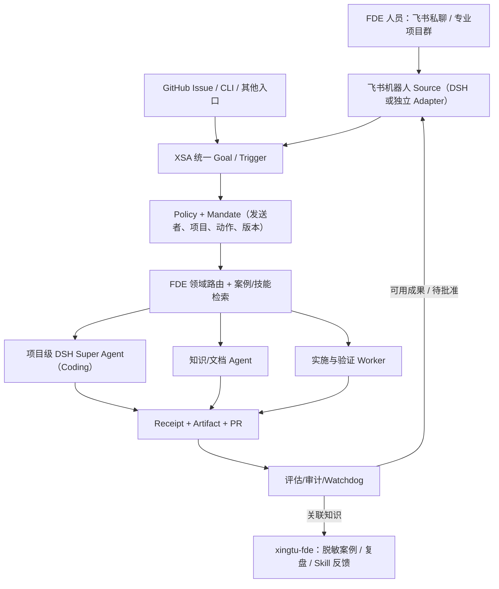

# xingtu-fde｜独立仓立项与飞书统一入口设计

> 状态：产品仓规划，`xingtu1996/xingtu-fde` 尚未创建，任何部署/创建仓库动作需独立执行与回执。此文档先暂存 XSA 的独立 Draft PR。  
> 角色定位：FDE 领域知识与交付方法资产库；**不是**重新做一套 XSA / DSH / BPMN 引擎。

## 产品一句话

**XingTu FDE — 从需求发现到工程交付，把一线解决问题的方法、证据、技能和案例沉淀成可复用的工作系统。**

XSA 负责通用 Goal/Agent/Trigger/Task/Receipt/Policy；DSH Super Agent 可做单仓主动 Coding Agent，飞书/Lark 可以是一个可选的统一任务入口。FDE 自己主要沉淀领域模型、案例、Skills、交付规范、知识资产和领域工作流模板。

## 六层资产

1. **Playbooks（方法论）**：售前需求澄清→机会评估→PoC→方案设计→现场实施→验收与运营→知识转交。
2. **Cases（案例）**：业务问题、约束、目标、方案、选型、错误尝试、证据、复盘；公开匿名案例与私有原始案例分层。
3. **Skills（能力包）**：案例挖掘、需求澄清、架构评审、风险识别、验收清单、实施复盘；优先复用 `xingtu-skills`，只在 FDE 特异能力被证明有必要时新增。
4. **Templates（交付模板）**：Statement of Work、需求调研、Epic、SDD、验收标准、PoC 测试、交接记录、复盘卡。
5. **Workflows（编排定义）**：FDE 业务流程的 DAG/BPMN/状态与审批模板，由 XSA/DSH/外部引擎执行，不在 FDE 仓自建 Runtime。
6. **Evidence（证据与演进）**：每个案例有来源等级、脱敏状态、引用和可公开/私有边界。学术引用与用户自述分开。

## 可选的飞书机器人统一入口



注意：DSH Super Agent 是单仓研究原型，不要让同一个原型无隔离地持有多个客户/仓的全量权限。可采用“一个项目一个隔离部署/执行主体 + XSA 协同层”作为**待实测设计**。飞书机器人需要组织授权、应用发布、消息/成员权限以及安全审查；不可用未经授权账号进行消息抓取。

### 如何借鉴 [DSH 006 Deployment](https://github.com/deepseek-ai/dsh-superagent-prototype/blob/main/docs/006-deployment.md)

- 独立 profile、独立 bot GitHub 身份与专门的状态目录；不和个人日常 DSH profile 混用。
- DSH 原型可选 Feishu Source；上游示例采用 Feishu 自建应用、`lark-cli`、独立的 bot 配置与回话通道。必须实测版本兼容，不能仅凭文档直接填凭据运行。
- Source 的 allowed sender / chat scope、Policy 与 Mandate 是权限核心；不能把飞书群里任何消息都当执行指令。
- 每 Ticket/工作项独立目录和 Session；较高风险动作等待人工核准。
- 面板聚焦“现在需人处理什么”，日常不要制造重复消息。

### 为什么“一个飞书入口”不是“唯一入口”

用户可能用 GPT Chat、Muse、工作空间、Coding Agent、GitHub、飞书提出需求。XSA 原则是 **Any Authorized Source**，飞书只是适合企业协作的一种渠道；FDE 学习和案例仍应支持独立 CLI、文件与 GitHub 工作流。来源不同但任务 ID、授权链和交付证据一致。

## FDE 仓库建议结构

```text
xingtu-fde/
├── README.md                     # 中文主入口、定位与使用路径
├── README.en.md
├── LICENSE
├── SECURITY.md
├── CONTRIBUTING.md
├── AGENTS.md                     # Agent 参与边界与脱敏规则
├── docs/
│   ├── PHILOSOPHY.md
│   ├── ARCHITECTURE.md
│   ├── ROADMAP.md
│   ├── references.md
│   └── decisions/
├── playbooks/
│   ├── discovery/
│   ├── poc/
│   ├── implementation/
│   └── handover/
├── cases/
│   ├── public/
│   ├── examples/                 # 合成数据示例明确标注
│   └── CASE_TEMPLATE.md
├── skills/
│   └── README.md                 # FDE 专属扩展和 xingtu-skills 引用索引
├── templates/
│   ├── requirements.md
│   ├── poc-acceptance.md
│   └── project-handover.md
├── workflows/
│   └── README.md                 # 流程定义而非部署引擎
├── examples/
│   └── feishu-entry/
└── .github/
    └── PULL_REQUEST_TEMPLATE.md
```

## 与现有 xingtu-* 仓库复用关系

| 上游仓 | 复用方式 | 避免重复 |
|---|---|---|
| [xingtu-ai-engineering](https://github.com/xingtu1996/xingtu-ai-engineering) | FDE 能力模型、质量门禁、AI 工程方法论 | FDE 专注领域案例，不复写通用工程体系 |
| [xingtu-sdd](https://github.com/xingtu1996/xingtu-sdd) | 需求规格、可测试验收、交付记录 | 引用现有模板并按业务场景作扩展 |
| [xingtu-skills](https://github.com/xingtu1996/xingtu-skills) | 场景 Skill、事实检查、工程工具、职业能力 | 专属 Skill 先做清单和适配，不复刻 137 个 Skills |
| [xingtu-harness](https://github.com/xingtu1996/xingtu-harness) | 跨场景一键装配与 `presale` 等场景 | 复用安装入口，不新建脚手架系统 |
| [xingtu-super-agent](https://github.com/xingtu1996/xingtu-super-agent) | 目标、事件、Policy、派工、回执、质量治理 | 不自己实现 Agent Orchestrator |
| [xingtu-learn](https://github.com/xingtu1996/xingtu-learn) | 学习过程、实验、反例与知识来源 | 已验证方法蒸馏到 FDE，探索过程留 Learn |

## 两个第一批开放案例（仅建议，不是已证实的真实客户）

**Case A · 从模糊需求到可验收 PoC**：输入匿名假设需求；分别由咨询/架构/测试 Agent 协作输出目标、约束、指标、PoC 规格、风险，人工确认。严格标明 *synthetic example*。

**Case B · 项目交付与知识回流**：输入合成的项目 Epic→分解→执行→回执→交付验收→方法卡片，记录每次判断和失败案例。绝不公开客户合同、内部源码、真实个人数据。

## 项目价值衡量（假设）

- 首次需求澄清耗时、需求返工率、PoC 验收准备耗时。
- 人工从工具切换/转述任务的次数、跨岗位交接回合。
- 可引用案例占比、证据缺失率、技能实际复用成功率。
- 单个合格交付成果的人工+模型+执行成本。

## 建仓与执行边界

当前 GitHub 连接无建新仓接口：应让已有获授权的 Muse/本地工具创建 `xingtu1996/xingtu-fde` 公共空仓及 MIT LICENSE，之后 ChatGPT 可通过 GitHub 在**独立分支**迁入文档，提交 Draft PR。建仓前需查询是否已存在；不要覆盖现有仓。公开仓默认只放匿名或合成案例，真正敏感资料留私有存储并提供可公开的引用标识。

最小版本优先 **README + 2 个合成案例 + 3 个 FDE 模板 + Skill 关联索引**。飞书统一入口与 DSH 运行时属于后续单独验证任务，不应阻碍 FDE 知识仓先形成可用内容。
