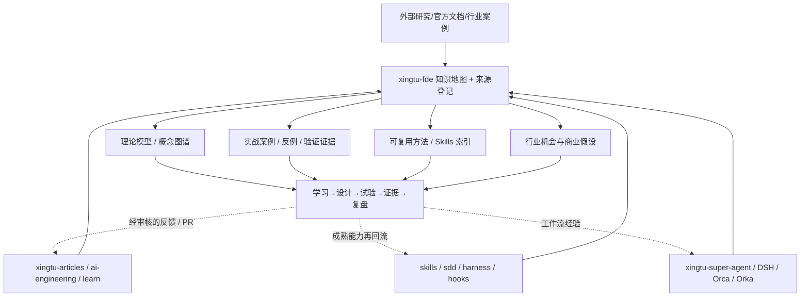

# xingtu-fde｜FDE 理论、知识与实战资产中枢（修订版）

> 2026-11-02 · 设计草案 / 待独立建仓。**本次定位纠偏**：此前草案过于强调交付模板、飞书机器人和执行工作流；用户明确要求 FDE 仓首先是跨行途开源矩阵的**理论知识储备 + 实战知识储备 + 行业机会研究中心**。  
> 不是重新开发 XSA、DSH、工作流引擎，也不把所有已有仓库的内容原样复制。  
> 当前 `xingtu1996/xingtu-fde` 尚未由本次读取证实存在，建仓须另行确认。

## 一、使命与第一性原理

**XingTu FDE · Forward Deployed Engineering Knowledge Commons（行途 FDE 知识公地）**

从 FDE 岗位、业务、客户价值、交付方法、技术能力、商业模型和行业案例出发，收集、考证、关联、复盘和复用多仓知识。回答五个问题：

1. FDE 解决的真实业务问题是什么？哪些环节的价值能被验证？
2. 技术如何从 Prompt、Skill、Harness、Agent、流程编排转化为可交付的客户结果？
3. 行业有哪些可供借鉴的理论、方法、论文/开源工程和实践案例？
4. 行途的工程资产与实践中哪些能复用，哪些观点仍待验证？
5. 哪些商业机会是有证据支持的痛点，哪些只是受 DeepSeek Super Agent 启发的假设？



**XSA 是执行与跨 Agent 协同系统；FDE 是可独立读取、查询、研究与创作的知识系统。** 飞书、GitHub、DSH Source 或 XSA Adapter 只是访问这套知识的可选入口。

## 二、五类知识资产（不是五套系统）

| 资产 | 主要内容 | 证据要求 |
|---|---|---|
| Theory | FDE 定义、工作法、售前/实施/验收、组织与职责、AI 工程化、治理理论 | 原始来源、作者、日期、适用条件、争议 |
| Research | DeepSeek Super Agent 000–008、DSH、Orca/Orka、同行论文、技术趋势、竞品机制 | 官方/论文/案例分开；不能把技术原型当已验证商业价值 |
| Field Notes & Cases | 真实/第三方案例、踩坑、问题链、方案取舍、交付账本、复盘 | 亲历/转述/合成分级；脱敏；每条数字须有来源或标未核实 |
| Knowledge Graph & Asset Index | 各 `xingtu-*` 仓能力导航、知识关联、Skills、Playbook、模板、文章 | 链接原件和固定版本/Commit，不双份复制 |
| Opportunities | 行业需求、价值链、解决方案、潜在商业模式、实验与反证 | 区分观察、假设、验证结果；不能仅凭一个开源项目断言市场机会 |

## 三、推荐独立仓结构

```text
xingtu-fde/
├── README.md                   # 中文导航、知识地图、上手路径
├── README.en.md
├── LICENSE
├── AGENTS.md                   # 来源鉴别与隐私规则
├── docs/
│   ├── PHILOSOPHY.md
│   ├── KNOWLEDGE_MAP.md
│   ├── SOURCE_POLICY.md
│   └── ROADMAP.md
├── registry/
│   ├── sources.yaml            # 原文/文章/仓库资料索引
│   ├── repos.yaml              # xingtu-* 能力关系与来源
│   └── concepts.yaml           # 概念、同义词和关联
├── theory/                     # FDE、组织、工程、交付理论
├── research/
│   ├── dsh-superagent/
│   ├── harness/
│   ├── orchestration/
│   └── industry/
├── field-notes/                # 实践过程与失败复盘
├── cases/
│   ├── public/
│   ├── third-party/
│   └── synthetic/
├── patterns/                   # 跨案例提炼的可复用模式
├── skills/README.md            # FDE 专属索引，链接 xingtu-skills
├── opportunities/              # 价值链/市场假设/验证
├── templates/                  # 卡片、案例、来源登记模板
└── .github/                    # 人工审查与引用校验，初始不加自动抓取任务
```

## 四、跨仓索引，而不是复制仓库

| 主仓/来源 | 在 FDE 中的用途 |
|---|---|
| [xingtu-ai-engineering](https://github.com/xingtu1996/xingtu-ai-engineering) | 一线 AI 工程化方法论、质量治理、FDE 模型 |
| [xingtu-articles](https://github.com/xingtu1996/xingtu-articles) | 公开文章、FDE 专题、案例素材（按原链接引用） |
| [xingtu-skills](https://github.com/xingtu1996/xingtu-skills) | Skills 目录、按 FDE 能力映射与检索 |
| [xingtu-harness](https://github.com/xingtu1996/xingtu-harness) | 工程脚手架、场景化安装和跨工具资产 |
| [xingtu-sdd](https://github.com/xingtu1996/xingtu-sdd) | 需求规格、验收与可追溯交付 |
| [xingtu-learn](https://github.com/xingtu1996/xingtu-learn) | 未成熟研究、学习实验、纠偏与失败经验 |
| [xingtu-super-agent](https://github.com/xingtu1996/xingtu-super-agent) | Super Agent 协作系统、DeepSeek 学习与实践 |
| [dsh-superagent-prototype](https://github.com/deepseek-ai/dsh-superagent-prototype) | 主动式编码 Agent 的一手设计证据、行业探索引子 |

公共仓只维护**独立评论、摘要、索引和链接**；原文版权与许可证依来源分别保留。尤其 `xingtu-articles` 标有 CC BY-SA，不能不加处理直接把全文复制进 MIT 代码仓。

## 五、知识登记卡最小字段

```yaml
id: FDE-SRC-0001
title: "FDE 工作法：进场、在场、离场"
source_type: first_party_article
source_url: "https://github.com/xingtu1996/xingtu-articles/blob/main/articles/2026/09/2026-09-25-fde-working-method-three-stages.md"
source_commit_or_blob: "12f6df3a76b52c2cda771cce916f5e898fe0f7a2"
knowledge_domains: [fde-method, delivery]
claim_status: published_claim  # observed / third_party_claim / tested / hypothesis
verification: source_read
privacy: public
license_note: "link-only; retain original copyright"
updated_on: "2026-11-02"
```

固定 SHA 需明确标注是 **file blob SHA / commit SHA**，两者不可混用。对业务数字必须单独标注“来源陈述”或“经独立核实”。

## 六、统一入口：从访问方式看飞书、DSH 与 XSA


- 飞书机器人是适合团队 FDE 场景的**一个**交互终端，不是 FDE 的核心依赖，更不是唯一入口。
- DSH 原型 006 Deployment 介绍独立 Profile、专用 GitHub 身份、可选飞书自建应用及 `lark-cli`；实际部署需要真实应用权限、组织规则和测试。
- DSH 008 Cookbook 允许新增 Source 类型；XSA 可研究作为 DSH 插件或额外 Agent 工具调用 FDE 知识。
- **不接管私人/客户飞书聊天与凭据；不把多项目 FDE 的隐私数据塞入一个公共仓。**

## 七、由 Super Agent 看到的潜在行业机会（待研究）

1. **从协作工具到可信交付**：FDE 服务的价值不在“让 Agent 自动生成了什么”，而在验收、授权、风险和结果可交代。
2. **交付知识与 Agent 执行耦合**：一线问题与操作经验变成可查询知识，真实事件回流案例，提升下一次方案判断。
3. **低成本的专业能力组织**：目标级任务交接、专业 Agent 分工，减少人为协调；是否降低实际成本需 A/B 证据。
4. **组织知识治理**：从实际项目提炼无敏感信息的通用方法卡，形成公开知识资产与私有交付的合理边界。

这些是产品研究题目，不代表已验证需求、收入规模或 DeepSeek 官方商业战略。

## 八、第一阶段必须真正有用的东西

- 一份完整知识地图和最小来源登记制度。
- 对现有仓库及公开 FDE 文章完成初始导航，记录来源类型与真实性边界。
- 对 DeepSeek Super Agent 的 000–008 文档做理论与实践卡片，映射 FDE 场景。
- 从文章中提取 2–3 个“第三方自述/行途实践”案例索引，不把他人的项目说成自己亲历。
- 提供至少一个独立、真实有用的 FDE 案例卡模板；不会只是空目录。
- 先通过 Draft PR；不未经审核发布客户、同事、雇主及私人信息。

## 九、纠偏记录

- 初版：误把 FDE 主仓写成案例库 + 技能库 + 飞书任务/工作流引擎。
- 用户纠偏：它应是 **“理论知识集合与行业研究中心，汇集所有开源矩阵、FDE 实践和信息来源”**，并可由 DSH/XSA/飞书等访问。
- 修订：Knowledge Commons 为主体，入口和交付流程为可选扩展；核心目标是知识积累与可复用的专业判断。
