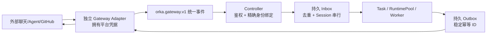

# XSA 技术研究：Orca、Orka、DeepSeek Harness 对照（2026-11-02）

> 研究状态：官方文档核验（非本地部署验证）。所有功能、命令均需以实际版本进行回归检查。此文件不构成任何上游项目的官方认可或兼容性声明。

## 背景与决策

XSA 的出发点是消除人作为多个 Agent 之间「复制粘贴/重述任务/找结果」的人工协调成本。当前场景：ChatGPT Chat 规划→用户转述→Muse 通过浏览器创建 GitHub 仓库→GitHub 留证→ChatGPT 读取审稿。Muse 实现了用户授权的 GUI 动作，但截图不代表两端已自动传输事件。

**建议：不要再造多 Coding Agent Runtime、通用工作流调度器和 DSH 核心；优先复用 Orca / Orka / DSH 自身机制。XSA 自持跨产品 Goal / Trigger / Capability / Mandate / Receipt 契约与审计。**

## 机制与真实能力

| 项目 | 已从官方资料确认 | 对 XSA 复用决策 | 不应过度宣称 |
|---|---|---|---|
| [stablyai/orca](https://github.com/stablyai/orca) | git worktree 隔离、多 CLI Agent 启动；实验性 Run / Task / Dispatch / supervised worker / DAG / decision gate； `worker_done` 带 taskId、dispatchId；CLI 支持启动重放 `operationId` | 优先作为 Coding Agent 本地协作执行器，验证 CLI Agent adapter，而非自研 Worktree Manager | 不等于自动接管 ChatGPT 普通会话和 Muse Personal 的 GUI 会话 |
| [orka-agents/orka](https://github.com/orka-agents/orka) | Kubernetes Controller、Task、Provider、Agent、分离 Publisher；Gateway adapter 通过 `orka.gateway.v1` 规范事件；持久 Inbox/Outbox、身份绑定、拒绝未知来源、重试幂等 | **优先研究 Gateway 适配协议**，大型团队部署时评估是否以 Orka 为执行后端 | Kubernetes 部署与基础设施开销较高；不是行途个人 MVP 的默认前置依赖 |
| [deepseek-ai/deepseek-harness](https://github.com/deepseek-ai/deepseek-harness) | Cordis 类型化事件、Service、可撤销 effect；profile、bundle 与 `dsh.bundle` 打包；Custom plugin indexes 提供可选 Discover | 设计 `dsh-xsa` 插件，将 DSH 作为 XSA 的可插拔入口/执行器 | 能安装插件不等于能自动从任意聊天 App 读取消息 |
| [dsh-superagent-prototype](https://github.com/deepseek-ai/dsh-superagent-prototype) | Source、Trigger、Eval、Ticket、Mandate、Assignment、Executor、Outbox 等设计；单状态写入者、事务及回执 | 主要设计哲学和领域模型来源 | 上游为研究原型，并非完全生产级或正式论文证明 |

### Orca 的具体做法

1. 为同一代码任务开独立 git worktree，启动不同 CLI Agent，各自修改独立分支，统一 Diff 审核。
2. 实验性 orchestration：`Run` 存命名空间和协调者信箱；`Task` 管工作项依赖/状态；`Dispatch` 是一次执行尝试；`Message` 用于进度、问题、心跳和 `worker_done`；决策门阻断待批准任务。
3. CLI 例子（仅文档示意，**此处未运行**）：
   ```sh
   orca status --json
   orca orchestration run-create --objective "Review XSA adapter"
   orca orchestration task-create --spec "Audit connector interface" --task-title "Audit"
   # 需取得实际 taskId 后：
   orca orchestration worker-start --task <taskId> --worktree new-child --name xsa-audit --agent codex --setup skip
   ```
4. 重要风险：Orca 部分 CLI 默认使用绕过审批参数，`git worktree` **不是安全沙箱**。使用行途私有或生产仓之前必须选择 Manual 权限、检查 Agent 启动参数、隔离凭据和网络权限。
5. 只有真实 Orca Runtime 运行通过，才把其 Capability 标记为 verified。

### Orka 的适配原理



- Adapter 不应把整个平台凭据交给任务执行器。
- GatewayClass 声明能力与契约版本，Gateway 指向 HTTPS Adapter，GatewayBinding 精确映射身份和 Agent；未知/冲突绑定失败关闭。
- Orka 把事件写入后才确认接收，并以稳定 ID 去重与保证回复重试安全。
- 对 XSA 的启示：**统一协议只管理用户目标和交接契约，不在控制层持有各种平台代理登录态**；把具体授权交给 Adapter，控制层保存最小必要关联信息。

### DSH 插件分发

DSH 标准 bundle 使用 `package.json` 中 `dsh.bundle.patch` 指向 `cordis.patch.yml`，配置加载插件模块。公开发布可通过 npm 或 Git 安装源；官方 Custom plugin indexes 为可自行发布的索引 JSON，默认不提供官方集中商店/自动收录。需要先验证本地安装、卸载、日志和版本兼容，才能发布插件索引。

此 PR 同时提供 `integrations/dsh-xsa-probe/` **只读无动作插件骨架**；它尚不具备 Task/Event/Receipt 的真正网络互通。

## 适配器选择矩阵

| 接入方式 | 例子 | 优先级 | 风险控制 |
|---|---|---|---|
| 原生 API/Webhook | GitHub、支持自定义接口的 Agent 平台 | P0 | 鉴权、签名、幂等、最小权限 |
| CLI / Runtime | Orca CLI、Codex CLI、DSH | P1 | 执行范围、隔离、终端句柄、会话复用 |
| 标准 Gateway / A2A | Orka gateway | P1 | 精确身份绑定、持久收发箱、租约 |
| Browser Computer Use | Muse Personal Agent 已观察到浏览器建仓 | P2 | GUI 易变、二次确认、不可把点击成功当最终成功 |
| 手工转述 | 当前 GPT→Muse | Baseline | 统一提示词交接包、保留证据、成本测量 |

## 验收实验（仍未执行）

- X1 Orca：两个 Agent 对两个隔离 worktree 工作，核对 Dispatch、worker_done、重复 launch 的 `operationId` 重放；验证 Manual 权限。
- X2 Orka：只读环境创建模拟 Gateway 事件，测试未知 sender 阻断、重复 eventId 不再执行、回复稳定幂等。
- X3 DSH：仅本地安装 probe，确认配置中包含插件且启动无对外写入，能卸载并回退；**之后**才可加任务/回执接口。
- X4 Muse：用截图和 GitHub 的创建时间、Commit SHA、PR 形成 evidence receipt；验证 GUI 对象是否真实落盘，不能从截图推导自动 webhook。

## 一手参考

1. Orca [Orchestration](https://github.com/stablyai/orca/blob/main/docs/site/content/docs/cli/orchestration.mdx)、[CLI 技能](https://github.com/stablyai/orca/blob/main/skill-guides/orca-cli.md)、[Supported Agents](https://github.com/stablyai/orca/blob/main/docs/site/content/docs/agents/supported.mdx)。
2. Orka [Architecture](https://orka-agents.github.io/orka/docs/architecture)、[Gateways](https://orka-agents.github.io/orka/docs/gateways)、[Gateway API](https://orka-agents.github.io/orka/docs/reference/gateway-api)。
3. DSH [Architecture](https://github.com/deepseek-ai/deepseek-harness/blob/master/docs/architecture.md)、[Package & Install](https://github.com/deepseek-ai/deepseek-harness/blob/master/docs/user/develop/basic/publish.md)、[Plugin indexes](https://github.com/deepseek-ai/deepseek-harness/blob/master/docs/user/guide/plugin-market.md)。
4. DSH Super Agent [Domain](https://github.com/deepseek-ai/dsh-superagent-prototype/blob/main/docs/001-domain.md)、[Architecture](https://github.com/deepseek-ai/dsh-superagent-prototype/blob/main/docs/007-architecture.md)。
