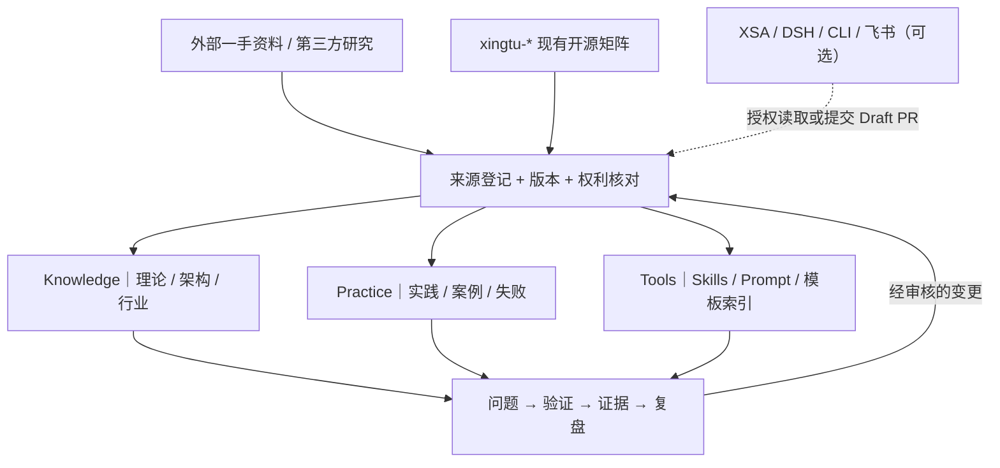

# XingTu FDE — FDE 开放知识与工程实践体系

> 行途 XingTu · 独立产品启动包 v0.1（2026-11-02）
>
> 当前文件暂存在 XSA 的 **隔离 Draft PR**，并不表示 `xingtu1996/xingtu-fde` 已创建、发布或正式部署。独立仓建立后迁移本目录内容，再进行公开验收。

**理论有来源，实践有证据，能力可复用。**

XingTu FDE 面向 Forward Deployed Engineering（前线部署工程）实践者，将**专业知识 Knowledge、工程实践 Practice、可复用工具 Tools** 连接成可阅读、可追溯、可验证的开放体系。它不是另一套 Agent 框架、纯笔记仓或未经证实的客户案例库。

## 读者从哪里开始

| 我想做什么 | 入口 | 可带走的成果 |
|---|---|---|
| 理解 FDE 工作方式 | [进场、在场、离场知识卡](knowledge/FDE-DELIVERY-LIFECYCLE.md) | 需求澄清、范围约束、验收、知识移交检查 |
| 查来源、区分事实与假设 | [来源注册表](registry/SOURCES.md) · [证据政策](docs/SOURCE_POLICY.md) | 原文、来源属性、核验状态和版本 |
| 借鉴交付案例 | [资金报表](cases/CASE-001-FUND-REPORT.md) · [数据清洗](cases/CASE-002-DATA-CLEANING.md) | 案例事实边界、可复用模式、反证问题 |
| 查现有能力 | [行途跨仓索引](registry/REPOS.md) · [Skills 映射](skills/README.md) | 回到原仓的技能与模板入口 |
| 研究 Agent 协同 | [DSH × XSA 边界](research/DSH-XSA-BOUNDARY.md) | 官方原型/现有实验/扩展假设的区别 |
| 研究商业机会 | [机会验证路线图](opportunities/VALIDATION-PLAN.md) | 低成本验证与拒绝条件 |
| 贡献与编写知识卡 | [模板](templates/CARDS.md) · [贡献规范](CONTRIBUTING.md) | 可直接复用的记录格式 |

## 产品知识地图

## 与其他仓库的边界

- **FDE**：专业知识、案例卡、研究与能力索引；默认静态文档即可使用。
- [xingtu-super-agent](https://github.com/xingtu1996/xingtu-super-agent)：目标管理和跨 Agent 编排研究。
- [xingtu-harness](https://github.com/xingtu1996/xingtu-harness)：工程资产聚合和实验。
- [xingtu-skills](https://github.com/xingtu1996/xingtu-skills)：技能原件及版本。
- [xingtu-learn](https://github.com/xingtu1996/xingtu-learn)：尚未验证的学习与实验。
- [xingtu-articles](https://github.com/xingtu1996/xingtu-articles)：原始公开文章；FDE 不复制全文。

## 可信度与开源边界

**公开不等于已核实。** 第三方自述、行途文章中的第一人称叙事、模拟示例和实验结果分别标注；没有独立证据不写“实测有效”。客户信息、原始会话、账号/Token、非授权引语和私有项目数据不进入公共仓。阅读 [SOURCE_POLICY](docs/SOURCE_POLICY.md) 和 [SECURITY](SECURITY.md)。

本启动包未选定独立仓内容/代码的最终许可证，迁移前必须完成来源版权审查并决定许可方式；引用上游不构成其背书。英文简介见 [README.en.md](README.en.md)。建设记录见 [BUILD_LOG](docs/BUILD_LOG.md)。
