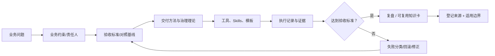

# FDE 知识地图与本体定义

## 核心工作问题

FDE 的交付链条可拆为：发现客户价值与约束 → 定义可验证结果 → 选择最小可行切口 → 技术与业务共同实现 → 对照基线验收 → 组织接管与复用。此为行途方法论，不是行业通行认证标准。来源：[行途三阶段工作法](../registry/SOURCES.md#fde-src-001)。

| 层 | 主题 | 应产生的材料 | 拒绝的伪成果 |
|---|---|---|---|
| Knowledge | FDE 岗位与职责、企业 AI 落地、SDD、质量治理、Agent 授权 | 来源卡、概念比较、适用边界与反例 | 未注明来源的“行业共识” |
| Practice | 需求/POC/上线/验收、真实过程、失败与复盘 | 业务基线、证据清单、差异对照、回退记录 | 只有截图或故事、没有验收口径 |
| Tools | Skill、Prompt、模板、检查表、工作流映射 | 输入/输出契约、原仓链接、前置条件、验证方法 | 把工具目录数当作已验证交付力 |

## 关系图

## 证据等级与转换

- **L0：待核对**：题目、发现线索、链接未读。
- **L1：已读来源**：可准确复述来源实际写了什么；*不等于证明来源说法真实*。
- **L2：外部或独立交叉核对**：独立原件、复测记录或第三方原始数据支持特定断言。
- **L3：行途复现实验**：记录输入修订、运行环境、命令、输出和失败复核；仅限已复测的指标。
- **L4：真实交付验收**：授权下的业务基线与验收证据；涉及私有交付时公共仓只留获批脱敏摘要。

证据等级不自动继承：一个案例“原文确实存在”(L1) 不能推导“案例所有数字经过独立认证”(L2)。

## 最小工作流

收录新文章 → 注册 URL/作者类型/日期/版本 → 抽取一条可被证伪的主张 → 标证据状态 → 写应用场景与反例 → 关联已有技能 → 小规模试验 → 保留修正或驳回记录。无需强制引入向量数据库或知识图谱服务。
