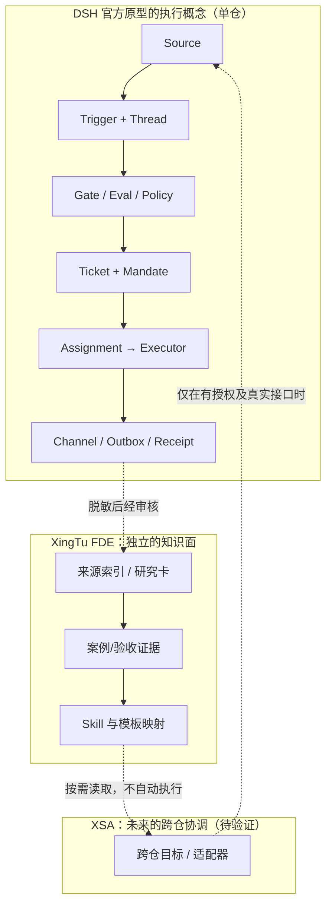

# DSH Super Agent 000–008 → FDE 知识化与 XSA 边界

**状态**：官方文档分析 + 行途设计推论，未部署或联调。上游明确说明 [dsh-superagent-prototype](https://github.com/deepseek-ai/dsh-superagent-prototype) 是研究原型、非 DeepSeek 正式产品；其发表版本与内部实现可能不同。另见 [DeepSeek Harness](https://github.com/deepseek-ai/deepseek-harness)：开发者预览，兼容性可能变化。

## 官方文档证据到应用的映射

| 文档 | 官方设计/原型描述 | 对 FDE 的知识价值 | 不应外推 |
|---|---|---|---|
| [000 Philosophy](https://github.com/deepseek-ai/dsh-superagent-prototype/blob/main/docs/000-philosophy.md) | 最少占用人的注意力，授权才执行 | 审批只在风险/结果节点提醒 | 不是 Agent 自动发布许可证 |
| [001 Domain](https://github.com/deepseek-ai/dsh-superagent-prototype/blob/main/docs/001-domain.md) | Source、Trigger、Thread、Eval、Policy、Mandate、Ticket、Assignment、Executor、Subscription、Channel | 把“请求、上下文、权限、任务、派工”分清 | 并非多仓跨云通用平台 |
| [002 Authorization](https://github.com/deepseek-ai/dsh-superagent-prototype/blob/main/docs/002-authorization.md) | Gate + Assessment；Policy 版本；Mandate 范围与恢复重校验 | 来源文章/聊天内容不可授予执行权限 | Prompt 内容不等于身份授权 |
| [003 Execution](https://github.com/deepseek-ai/dsh-superagent-prototype/blob/main/docs/003-execution.md) | 每个 Ticket 独立执行 Session/目录；报告、重试与状态 | 复盘执行证据与失败恢复 | “有会话”不等于具备隔离安全 |
| [004 Prompts](https://github.com/deepseek-ai/dsh-superagent-prototype/blob/main/docs/004-prompts.md) | Host 限制优先、路由与执行分离、Prompt 版本 | FDE 专用问答不必接管调度 | 不能用 Prompt 绕过权限 |
| [005 Panel](https://github.com/deepseek-ai/dsh-superagent-prototype/blob/main/docs/005-panel.md) | 待人工处理、工作状态与历史 | FDE 取证重人类需要决策的地方 | 不要立即另造看板 |
| [006 Deployment](https://github.com/deepseek-ai/dsh-superagent-prototype/blob/main/docs/006-deployment.md) | 专用 Profile、bot GitHub 身份、可选 Feishu | 把研发和客户环境隔离 | 不表示飞书机器人已开通 |
| [007 Architecture](https://github.com/deepseek-ai/dsh-superagent-prototype/blob/main/docs/007-architecture.md) | Engine 单一写者、Effects/Outbox 持久回执 | 幂等执行与可追溯报告值得研究 | 不能复制 Engine 当新 FDE Runtime |
| [008 Cookbook](https://github.com/deepseek-ai/dsh-superagent-prototype/blob/main/docs/008-cookbook.md) | 示例 Source 的触发转换、身份、回复、轮询 | XSA 自定义事件 Source 的探索路径 | 示例 `hookq` 是虚构 CLI，不是可安装接口 |

## 概念图：官方执行路径 vs FDE

## 行途现状（不是上游实现）

- XSA [研究 PR #2](https://github.com/xingtu1996/xingtu-super-agent/pull/2) 是未合并的方案。
- Event Bridge [实验 PR #4](https://github.com/xingtu1996/xingtu-harness/pull/4) 描述了内存 Mock、回执和 Watchdog，尚未验证生产持久化、安全和真实 Agent API。
- FDE 不强制依赖 DSH、飞书、Codex、Claude Code、Muse 或 OpenCode；未来如需提供连接器，先制定只读能力契约，列身份、授权、数据最小化、幂等和回滚规则。

## 可验证的最小实验

E0 阅读上游安全/许可与接口；E1 在隔离的实验环境、专用 bot 身份跑只读 GitHub Source；E2 重复 Trigger 不重复生成副作用；E3 无授权 actor 不触发任务；E4 Outbox 异常重试不重复回话；E5 停止/过期/撤权时不继续执行。每个步骤要求运行日志和 commit SHA。任何一步未完成，公开展示只写“设计/待测试”。
